# Char-Griller 980 DIY Controller — Visual Wiring Diagram

This document provides visual diagrams and circuit breakdowns for assembling the Char-Griller 980 ESP32 controller.

---

## 1. System Power & Signal Flow

```mermaid
flowchart TD
    PSU["12V DC Power Supply (3A-5A)"] -->|12V Main| BUCK["LM2596 Buck Converter\n(Tune to 5.0V output)"]
    PSU -->|12V High-Side| INA_IN["INA219 Current Sensor\n(VIN+)"]
    
    BUCK -->|5.0V Rail| ESP_VIN["ESP32 (VIN / 5V)"]
    BUCK -->|5.0V Rail| TM1["TM1637 #1 (Current Temp)"]
    BUCK -->|5.0V Rail| TM2["TM1637 #2 (Setpoint)"]
    BUCK -->|5.0V Rail| BZ["Active 5V Buzzer (+)"]

    ESP_3V3["ESP32 3.3V Pin"] -->|3.3V Logic| INA_VCC["INA219 (VCC)"]
    ESP_3V3 -->|3.3V Logic| MAX_VCC["MAX31865 (VIN)"]

    INA_OUT["INA219 (VIN-)"] -->|12V Switched| FAN["12V Stock Fan (+)"]
    FAN -->|Fan Return| MOS_D["MOSFET Drain (IRLZ34N)"]
    MOS_S["MOSFET Source"] -->|Power Ground| STAR_GND["Central Star Ground Point"]

    subgraph ESP32_GPIO["ESP32 Control Lines"]
        direction TB
        G16["GPIO16 (PWM 25kHz)"] -->|220Ω Gate Resistor| MOS_G["MOSFET Gate"]
        G4["GPIO4 (Active HIGH)"] --> BZ_SIG["Buzzer (-) / NPN Driver"]
        G13["GPIO13 (Pull-up)"] --> DOOR["Hopper Switch Harness / Toggle Switch"]
        G21_17["GPIO21 (SDA) / GPIO17 (SCL)"] --> INA_BUS["INA219 (I2C)"]
        SPI_BUS["GPIO18 (CLK) / GPIO19 (MISO)\nGPIO5 (MOSI) / GPIO14 (CS)"] --> MAX_BUS["MAX31865 (SPI)"]
        G23_26["GPIO23 (CLK) / GPIO26 (DIO)"] --> TM1
        G25_22["GPIO25 (CLK) / GPIO22 (DIO)"] --> TM2
        G32_33_27["GPIO32 (A) / GPIO33 (B)\nGPIO27 (Button)"] --> ENC["KY-040 Rotary Encoder"]
    end
```



---

## 2. Complete Pin-to-Pin Interconnect Map

```mermaid
graph LR
    subgraph ESP32["ESP32-DevKitC (38-pin 32U)"]
        VIN["VIN (5V In)"]
        GND1["GND"]
        P3V3["3V3"]
        P4["GPIO4"]
        P5["GPIO5 (MOSI)"]
        P13["GPIO13 (Door)"]
        P14["GPIO14 (CS)"]
        P16["GPIO16 (PWM)"]
        P17["GPIO17 (SCL)"]
        P18["GPIO18 (CLK)"]
        P19["GPIO19 (MISO)"]
        P21["GPIO21 (SDA)"]
        P22["GPIO22 (DIO2)"]
        P23["GPIO23 (CLK1)"]
        P25["GPIO25 (CLK2)"]
        P26["GPIO26 (DIO1)"]
        P27["GPIO27 (Btn)"]
        P32["GPIO32 (Enc A)"]
        P33["GPIO33 (Enc B)"]
    end

    subgraph MAX["MAX31865 RTD Amp"]
        M_VIN["VIN (3.3V)"]
        M_GND["GND"]
        M_CLK["CLK"]
        M_SDO["SDO (MISO)"]
        M_SDI["SDI (MOSI)"]
        M_CS["CS"]
        M_RTD["RTD+ / RTD-"]
    end

    subgraph INA["INA219 Current Sensor"]
        I_VCC["VCC (3.3V)"]
        I_GND["GND"]
        I_SCL["SCL"]
        I_SDA["SDA"]
        I_VP["VIN+ (12V in)"]
        I_VM["VIN- (12V out to fan)"]
    end

    subgraph DISP1["TM1637 Display 1 (Current)"]
        D1_VCC["VCC (5V)"]
        D1_GND["GND"]
        D1_CLK["CLK"]
        D1_DIO["DIO"]
    end

    subgraph DISP2["TM1637 Display 2 (Setpoint)"]
        D2_VCC["VCC (5V)"]
        D2_GND["GND"]
        D2_CLK["CLK"]
        D2_DIO["DIO"]
    end

    subgraph ENCODER["KY-040 Rotary Encoder"]
        E_CLK["CLK (A)"]
        E_DT["DT (B)"]
        E_SW["SW (Button)"]
        E_GND["GND"]
    end

    subgraph DOOR_SW["Hopper Switch / Toggle"]
        SW_SIG["Signal (GPIO13)"]
        SW_GND["GND"]
    end

    %% Connections
    P3V3 --> M_VIN
    P3V3 --> I_VCC

    P18 --> M_CLK
    P19 --> M_SDO
    P5 --> M_SDI
    P14 --> M_CS

    P17 --> I_SCL
    P21 --> I_SDA

    P23 --> D1_CLK
    P26 --> D1_DIO

    P25 --> D2_CLK
    P22 --> D2_DIO

    P32 --> E_CLK
    P33 --> E_DT
    P27 --> E_SW

    P13 --> SW_SIG
```



---

## 3. Fan Control & Current Sensing Circuit

```
  +12V Supply Rail
         │
         ▼
   ┌───────────┐
   │  INA219   │
   │  VIN+     │
   │           │
   │  VIN-     │
   └─────┬─────┘
         │ +12V through shunt
         ▼
     ┌───────┐
     │  FAN  │ 12V Fan (+)
     │       │
     │       │ 12V Fan (-)
     └───┬───┘
         │
         ├────────────────────┐
         │                    │
         ▼                    ▲ Cathode (Stripe)
      ┌─────┐               ┌───┴───┐
      │  D  │ MOSFET Drain  │ 1N4007│ Flyback Diode
      │     │               └───┬───┘
 ESP32│  G  │ MOSFET Gate       │ Anode
 GPIO16──[ 220Ω ]──┤     │              │
      │     │                   │
      │  S  │ MOSFET Source     │
      └──┬──┘                   │
         │                      │
         ├──────────────────────┘
         ▼
  Central Star Ground (GND)
```

> [!IMPORTANT]
> - **Gate Resistor**: 220Ω between ESP32 GPIO16 and MOSFET Gate limits inrush current to the ESP32 pin.
> - **Gate Pull-Down**: An optional 10kΩ resistor from Gate to GND ensures the fan stays OFF while the ESP32 is booting.
> - **Flyback Diode (1N4007)**: Must be installed with the cathode (stripe) to Fan (+) and anode to Fan (-) to absorb inductive voltage spikes when the PWM switches off.
> - **Logic-Level MOSFET**: Must use **IRLZ34N** (or equivalent logic-level N-channel MOSFET with Vgs threshold < 2.5V). Standard IRF-series MOSFETs will NOT fully turn on with 3.3V logic!

---

## 4. MAX31865 RTD Module Setup (for Stock PT1000 Probe)

The Char-Griller 980 factory probe (Part #801126) is a **2-wire PT1000 RTD** (approx 1080Ω at room temp).

```
   MAX31865 Breakout
 ┌─────────────────────┐
 │ VIN   ──> ESP32 3V3 │
 │ GND   ──> ESP32 GND │
 │ CLK   ──> GPIO18    │
 │ SDO   ──> GPIO19    │
 │ SDI   ──> GPIO5     │
 │ CS    ──> GPIO14    │
 ├─────────────────────┤
 │ RTD+  ──> Probe W1  │ ──> Stock PT1000 Pit Probe (2-wire Molex)
 │ RTD-  ──> Probe W2  │     (No polarity)
 └─────────────────────┘
```

### Required Board Modifications:
1. **Bridge the "2WIRE" solder jumper**: On Adafruit/generic MAX31865 boards, solder the 2-wire jumper pads together. Cut the trace between the 3-wire jumper pads if bridged.
2. **Reference Resistor ($R_{ref}$)**:
   - Factory boards ship with a **430Ω** ($R_{ref}$) resistor designed for PT100 sensors.
   - For a **PT1000** sensor, $R_{ref}$ must be **4300Ω (4.3kΩ, 0.1% tolerance)**.
   - You can buy pre-configured PT1000 MAX31865 modules or solder a 4.3kΩ 0.1% resistor in place of the 430Ω resistor.

---

## 5. Charcoal Hopper Safety Switch Wiring

```
                       ESP32 GPIO13 (Internal Pull-Up enabled)
                                │
                                ▼
 ┌──────────────────────────────────────────────────────────────┐
 │ OPTION 1: Stock Harness (Upper Lid + Lower Ash Door)        │
 │                                                              │
 │   GPIO13 ──[ Upper Hopper Lid NC ]──[ Lower Ash Door NC ]── GND
 │                                                              │
 │   - Both doors closed = Circuit complete to GND = 0V (LOW)   │
 │   - Either door open  = Circuit open = 3.3V (HIGH)           │
 └──────────────────────────────────────────────────────────────┘

 ┌──────────────────────────────────────────────────────────────┐
 │ OPTION 2: Manual SPST Toggle Switch (Bypassed stock switches)│
 │                                                              │
 │   GPIO13 ─────────[ ON / OFF Toggle ]───────── GND           │
 │                                                              │
 │   - Switch ON  (Closed) = Run Mode (0V / LOW)                │
 │   - Switch OFF (Open)   = Chamber Open / Fan Paused (3.3V)   │
 └──────────────────────────────────────────────────────────────┘
```

---

## 6. Star Grounding Architecture

To prevent motor PWM switching noise from interfering with delicate SPI/I2C sensor readings, use a **single-point star ground**:

```
                         ┌───────────────────────┐
                         │   12V Power Supply    │
                         │    Negative (-)       │
                         └──────────┬────────────┘
                                    │ 18 AWG Heavy Wire
                                    ▼
                         ╔═══════════════════════╗
                         ║   STAR GROUND POINT   ║
                         ╚══════════╦════════════╝
       ┌────────────────────────────┼────────────────────────────┐
       │ 18 AWG                     │ 22 AWG                     │ 22 AWG
       ▼                            ▼                            ▼
┌──────────────┐             ┌──────────────┐             ┌──────────────┐
│ MOSFET Source│             │ LM2596 Buck  │             │  ESP32 GND   │
│ (Fan Return) │             │ (Output GND) │             └──────┬───────┘
└──────────────┘             └──────────────┘                    │
                                                ┌────────────────┼────────────────┐
                                                │                │                │
                                                ▼                ▼                ▼
                                           ┌─────────┐      ┌─────────┐      ┌─────────┐
                                           │MAX31865 │      │ INA219  │      │ Displays│
                                           │   GND   │      │   GND   │      │ & Switch│
                                           └─────────┘      └─────────┘      └─────────┘
```
